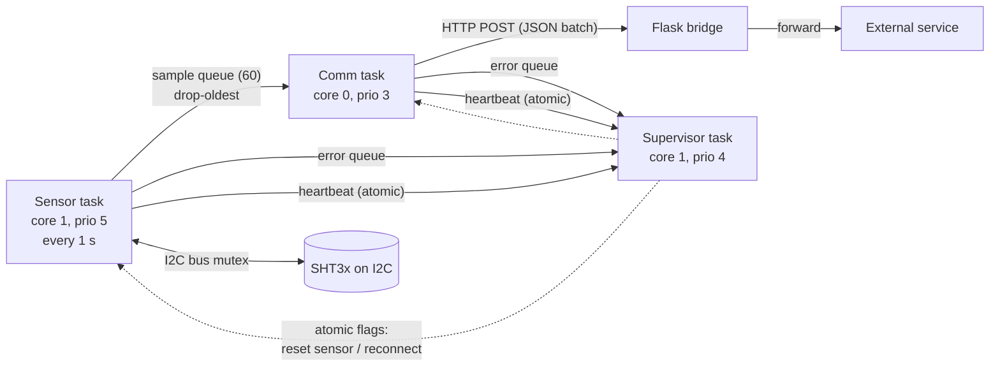

# ESP32 Sensor Monitor – FreeRTOS Edition

[](https://github.com/Jatin1Mathur/esp32-rtos-sensor-monitor/actions/workflows/ci.yml)

Firmware for an ESP32 (M5Stack Core) that samples an SHT3x temperature/humidity
sensor over I²C and sends the data over Wi‑Fi to a Python Flask bridge.

This is the **RTOS redesign** of my earlier Arduino "super-loop" firmware.
In the super-loop, reading the sensor, sending over HTTP and handling errors
ran one after another in `loop()`, so a slow or dead network also blocked the
sensor and made the sample timing irregular. Here the work is split into
FreeRTOS tasks with clear ownership, and the concurrency logic is tested on
the host with GoogleTest and ThreadSanitizer.

**Real data, no hardware needed.** Instead of invented numbers, the project
replays **2,665 real office-room measurements** (UCI/Kaggle *Occupancy
Detection* dataset, CC BY 4.0, see [`data/README.md`](data/README.md)) through
the same tasks, queues and bridge. A `ReplaySensor` implements the same
`ISensor` interface as the SHT3x driver, so nothing else changes.

## Architecture



| Task | Core | Prio | Trigger | Owns | Never does |
|---|---|---|---|---|---|
| **Sensor** | 1 | 5 | `vTaskDelayUntil`, 1 s fixed period | SHT3x sensor | block on the network or a full queue |
| **Supervisor** | 1 | 4 | error queue, 500 ms timeout | error policy | touch the sensor or Wi‑Fi itself |
| **Comm** | 0 | 3 | sample queue | Wi‑Fi, HTTP client | decide recovery on its own |

* The **sensor task** has the highest priority because its timing matters most.
  `vTaskDelayUntil` keeps the period exact (no drift from the measuring time).
* The **comm task** runs on core 0 next to the ESP32's Wi‑Fi stack and batches
  up to 10 samples per request.
* The **supervisor** holds the whole error policy in one place
  ([`supervisor.cpp`](lib/sm_core/src/supervisor.cpp)):
  3 sensor errors → soft reset sensor, 3 failed resets → restart device,
  3 comm errors → reconnect Wi‑Fi, missing heartbeat → restart.
* Arduino's own `loop()` task deletes itself, since all work lives in tasks.

## Synchronization issues and how they are handled

| Problem | Where it would happen | Solution in this code |
|---|---|---|
| **Race conditions on shared data** | samples and errors passed between tasks | Only small structs are passed **by value** through FreeRTOS queues; no shared globals, no pointers between tasks |
| **Shared I²C bus** | sensor driver plus any other I²C device | Bus guarded by a FreeRTOS **mutex**; every transaction takes it with a **timeout** (`LockGuard`), never `portMAX_DELAY` |
| **Holding a lock too long** | the SHT3x needs ~15 ms to convert | Mutex is released **during** the conversion and taken again to read (tested: `BusIsReleasedDuringConversionTime`) |
| **Priority inversion** | low-prio task holds the bus, sensor task waits | A FreeRTOS mutex (not a binary semaphore) has **priority inheritance**; short critical sections |
| **Deadlock** | two tasks waiting for each other's locks | Only one lock in the system, always taken with timeout; never held during network I/O |
| **Starvation** | a task re-takes a mutex immediately after releasing it | Mutexes are not FIFO-fair. The threaded simulation hit exactly this (the sensor only got `BusBusy`); kept as a regression test |
| **Backpressure / queue overflow** | Wi‑Fi down, comm task stops draining | Sensor uses `push_drop_oldest` with **timeout 0**: it never blocks, the newest data is kept, drops are counted and sent to the server, which checks them against sequence-number gaps |
| **Flooding the error queue** | thousands of drops during a long outage | Only the first drop of an outage is reported; error reports also use drop-oldest |
| **Two tasks controlling one resource** | supervisor resetting the sensor while the sensor task measures | The supervisor only sets an **atomic request flag**; the owning task performs the reset in its own context |
| **Detecting a hung task** | blocked HTTP call, deadlock, infinite loop | Each task writes a **heartbeat** into a lock-free table (one writer per slot, acquire/release); the supervisor restarts the device if one is older than 5 s. Long backoffs sleep in slices and keep beating (`sleep_with_heartbeat`); the HTTP timeout (3 s) stays below the heartbeat timeout |
| **Timer wrap-around** | millisecond tick counter overflows | Heartbeat ages use masked unsigned subtraction (tested at the wrap point) |
| **Heap fragmentation** | device running for weeks | Queues and mutex use **static allocation** (`xQueueCreateStatic`); JSON is written into a fixed buffer with `snprintf`, no `String` |
| **Stack overflow** | per-task stacks are fixed | Stack high-water marks are logged every 10 s (`uxTaskGetStackHighWaterMark`) |
| **Lost data during short outages** | HTTP fails mid-batch | The failed batch is kept and retried with exponential backoff (store-and-forward); the bridge ignores duplicates |

## How it is tested

The core logic in [`lib/sm_core`](lib/sm_core) depends only on small
interfaces (`IQueue`, `ILock`, `II2cBus`, `IClock`, …). The firmware plugs in
FreeRTOS/Arduino implementations ([`src/platform`](src/platform)); the host
tests plug in fakes and `std::thread` versions with the same semantics.

* **Driver tests** (GoogleMock): exact I²C command bytes, CRC check against the
  datasheet example, bit-flip detection, NACK and bus-busy paths, lock released
  on every path.
* **Policy tests**: escalation thresholds, recovery after success, heartbeat
  timeout and wrap-around, backoff cap.
* **Task tests**: one iteration of each task with fakes (Wi‑Fi down, HTTP 503,
  queue overflow, reset requests).
* **Threaded simulation** ([`test_pipeline_sim.cpp`](host_tests/test_pipeline_sim.cpp)):
  the real task code runs on 3 threads plus a competing bus user, with a network
  outage in the middle. It checks that sequence numbers arrive in order and that
  **delivered + dropped = generated**, so no sample is ever lost without being
  counted.
* **Real-data replay** ([`test_dataset_replay.cpp`](host_tests/test_dataset_replay.cpp)):
  all 2,665 recorded readings go through sensor → queue → comm → HTTP with a
  200-second Wi‑Fi outage in the middle. Every value the server receives must be
  exactly the recorded value for that sequence number.
* **Flask bridge**: pytest with schema validation, gap/duplicate detection,
  forwarding failures, and the whole dataset sent through the bridge.

In total: 39 C++ tests and 16 Python tests.

CI (GitHub Actions) builds with GCC and Clang (warnings as errors), runs the
tests under **ASan/UBSan** and **ThreadSanitizer** (repeated 5×), runs the
bridge tests, and builds the ESP32 firmware with PlatformIO.

## Build and run

**Host tests**
```bash
cmake -S . -B build && cmake --build build -j && ctest --test-dir build
cmake -S . -B build-tsan -DSANITIZE=thread && cmake --build build-tsan -j && ctest --test-dir build-tsan
```

**Bridge**
```bash
cd server && pip install -r requirements.txt && pytest
FORWARD_URL=https://example.com/ingest python app.py    # FORWARD_URL is optional
```

**Demo without any hardware** (real data through the bridge)
```bash
cd server
python app.py                            # terminal 1: start the bridge
python replay_client.py --limit 100      # terminal 2: send 100 real readings
curl http://localhost:5000/api/devices/replay-01
```

**Firmware**
```bash
cp src/app_config.example.h src/app_config.h   # set Wi-Fi, bridge URL, I2C pins
pio run -e m5stack-replay -t upload            # M5Stack only, replays the dataset
pio run -e m5stack-sht3x  -t upload            # M5Stack + SHT3x (ENV unit on Port A)
pio device monitor
```

## Project layout

```
lib/sm_core/        platform-independent core (driver, tasks, supervisor, JSON)
src/main.cpp        FreeRTOS task creation and wiring
src/platform/       FreeRTOS / Arduino adapters (static queue, mutex, Wi-Fi, HTTP)
src/replay_data.h   dataset as a C array in flash (generated)
host_tests/         GoogleTest suite, threaded simulation, real-data replay
server/             Flask bridge, replay client, pytest
data/               real temperature/humidity dataset + source and license
tools/              script that converts the raw dataset
```

## Status

* Host tests, sanitizers and the bridge tests pass in CI; both firmware variants build in CI.
* Not yet run on a physical M5Stack (I don't have one yet); the replay build is ready for it.
* Next: measure real stack usage and timing jitter on the M5Stack, add a task
  watchdog (`esp_task_wdt`) in addition to the software heartbeat, and buffer
  samples in flash for outages longer than one minute.
